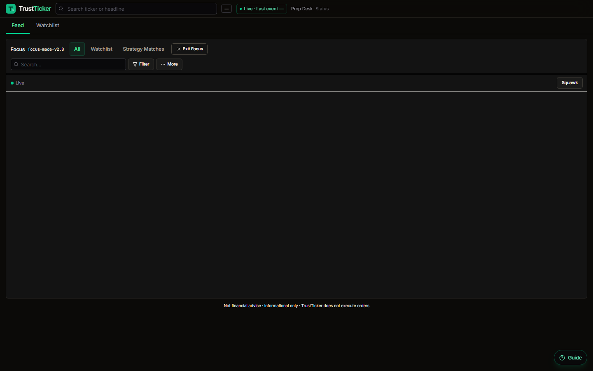
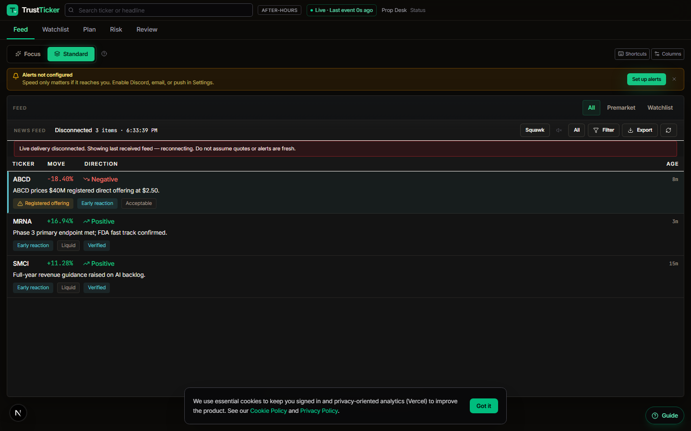
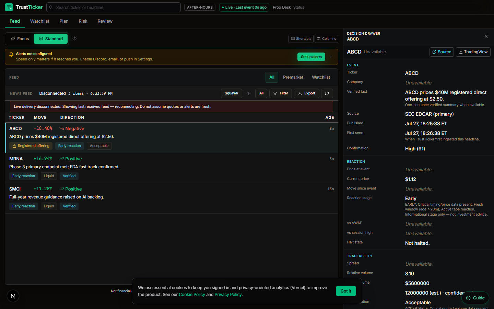
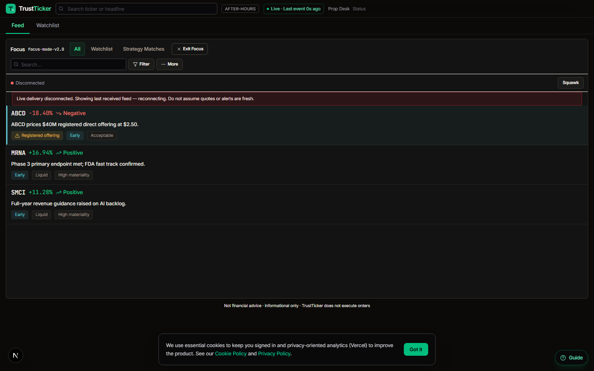
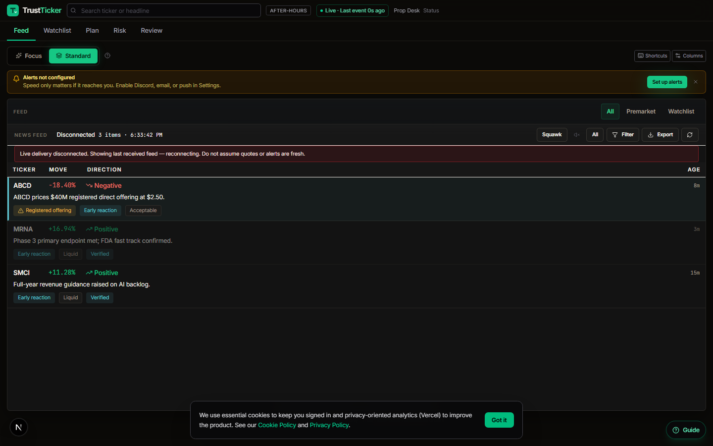
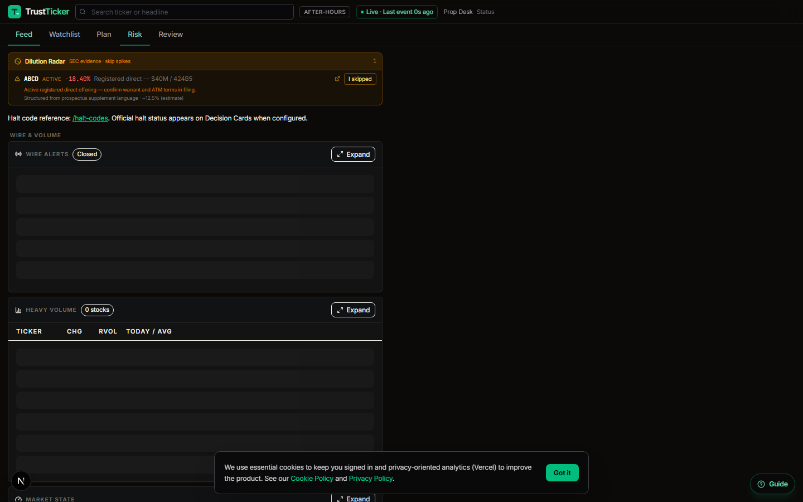
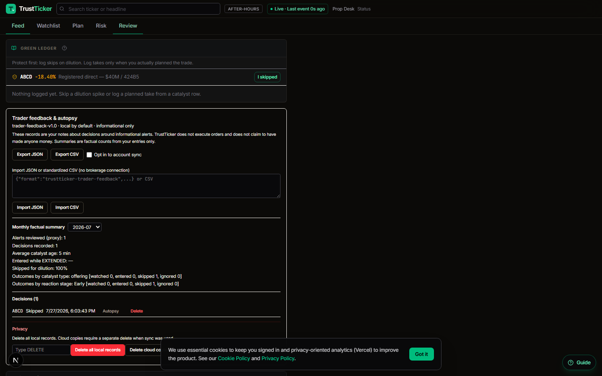
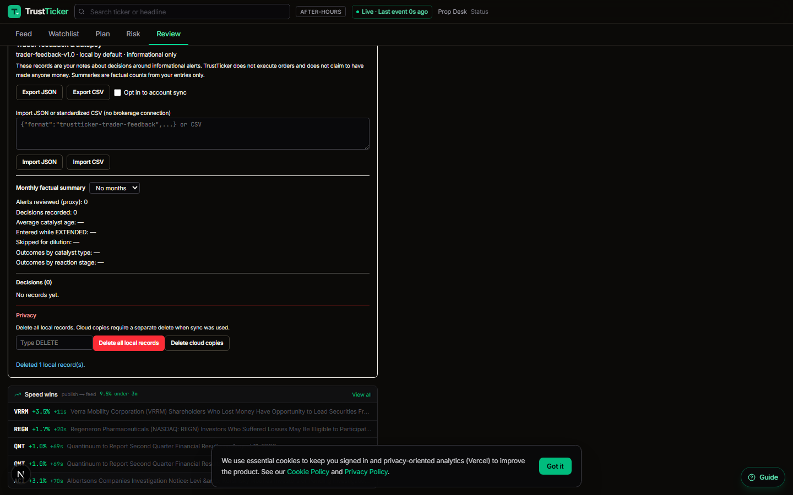
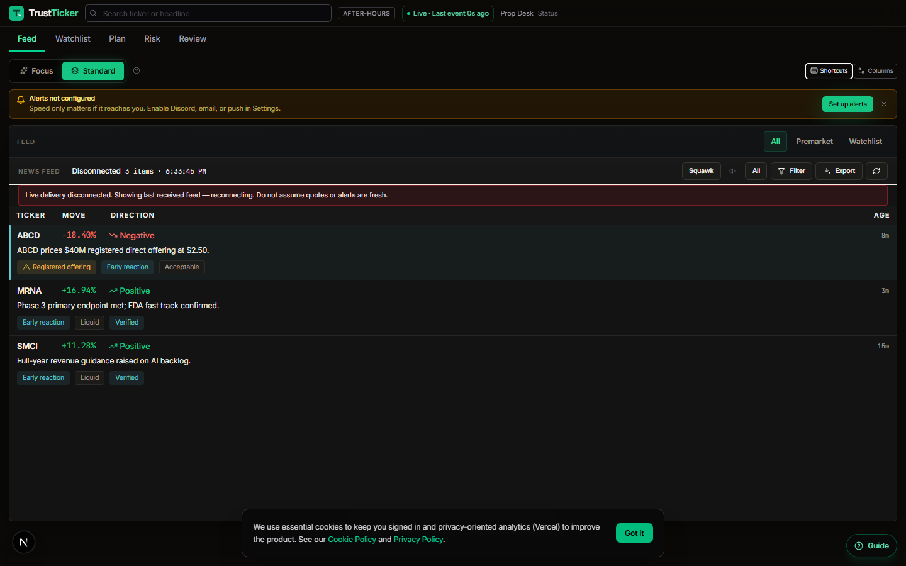

# TrustTicker workflow audit — Shell V3 / Feed V3 / Focus V2

Generated: 2026-07-27T22:32:07.044Z

## Verdict

**Redesign NOT complete** — 2 P0 failure(s) remain. Do not mark the redesign done.

| Severity | Count |
|----------|------:|
| P0 | 2 |
| P1 | 1 |
| P2 | 0 |
| Pass | 29 |

## Five usability questions

| # | Question | Expected answer in UI |
|---|----------|------------------------|
| 1 | What should the user look at first? | Connection status + Focus/top feed row (highest priority catalyst). |
| 2 | What changed recently? | Age label on the row + “Last event” in connection status. |
| 3 | Why does this event matter? | Headline / verified fact + materiality / reaction in drawer. |
| 4 | What is the primary risk? | Risk badge on row (≤3 badges) + Primary risks section in Decision Drawer. |
| 5 | What action inside the application is next? | Source / TradingView / Watchlist (W) / Focus / Risk / Review destinations. |

## P0 failures

### AQ-console — Browser console errors

- **Severity:** P0
- **Area:** quality
- **Detail:** A tree hydrated but some attributes of the server rendered HTML didn't match the client properties. This won't be patched up. This can happen if a SSR-ed Client Component used:

- A server/client branch `if (typeof window !== 'undefined')`.
- Variable input such as `Date.now()` or `Math.random()` which changes each time it's called.
- Date formatting in a user's locale which doesn't match the server.
- External changing data without sending a snapshot of it along with the HTML.
- Invalid HTML tag nesting.

It can also happen if the client has a browser extension installed which messes with the HTML before React loaded.

%s%s https://react.dev/link/hydration-mismatch 

  ...
    <RedirectBoundary>
      <RedirectErrorBoundary router={{...}}>
        <InnerLayoutRouter url="/e2e/workf..." tree={[...]} params={{}} cacheNode={{rsc:{...}, ...}} segmentPath={[...]} ...>
          <SegmentViewNode type="page" pagePath="e2e/workfl...">
            <SegmentTrieNode>
            <E2eWorkflowHarnessPage>
              

                

                <DashboardShellV3 initialCatalysts={[...]} initialWatchlist={[...]} initialFilters={null} ...>
                  <LiveQuoteProvider>
                    

                      <OnboardingChecklist>
                      <DashboardTopBar lastEventAt={Date} searchValue="" onSearchChange={function bound dispatchSetState}>
                        <header data-guide="dashboard-..." className="shrink-0 b...">
                          

                            <BrandHomeLink>
                            <label className="flex-1 min...">
                              
                              <Search>
                              <input
                                value=""
                                onChange={function onChange}
                                placeholder="Search ticker or headline"
                                className="w-full h-8 rounded-md border border-zinc-700 bg-zinc-950/80 pl-8 pr-2 text-..."
                                data-testid="global-ticker-search"
-                               style={{caret-color:"transparent"}}
                              >
                            ...
                      <DashboardSecondaryNav>
                      ...
                        <FocusModeV2 initialCatalysts={[...]} initialWatchlist={[...]} initialFilters={{}} searchValue="" ...>
                          <section className="desk-panel..." data-guide="focus-mode..." data-focus-mode="v2" ...>
                            

                              

                              

                                

                                  <Search>
                                  <input
                                    data-testid="focus-search"
                                    value=""
                                    onChange={function onChange}
                                    placeholder="Search…"
                                    className="w-full h-8 pl-7 pr-2 rounded border border-zinc-700 bg-zinc-950 text-[1..."
-                                   style={{caret-color:"transparent"}}
                                  >
                                ...
                            ...
                      ...
          ...
        ...
 | Failed to load resource: net::ERR_FAILED | Failed to load resource: net::ERR_FAILED | Failed to load resource: the server responded with a status of 401 (Unauthorized) | Failed to load resource: the server responded with a status of 401 (Unauthorized)

### AQ-hydration — Hydration warnings

- **Severity:** P0
- **Area:** quality
- **Detail:** A tree hydrated but some attributes of the server rendered HTML didn't match the client properties. This won't be patched up. This can happen if a SSR-ed Client Component used:

- A server/client branch `if (typeof window !== 'undefined')`.
- Variable input such as `Date.now()` or `Math.random()` which changes each time it's called.
- Date formatting in a user's locale which doesn't match the server.
- External changing data without sending a snapshot of it along with the HTML.
- Invalid HTML tag nesting.

It can also happen if the client has a browser extension installed which messes with the HTML before React loaded.

%s%s https://react.dev/link/hydration-mismatch 

  ...
    <RedirectBoundary>
      <RedirectErrorBoundary router={{...}}>
        <InnerLayoutRouter url="/e2e/workf..." tree={[...]} params={{}} cacheNode={{rsc:{...}, ...}} segmentPath={[...]} ...>
          <SegmentViewNode type="page" pagePath="e2e/workfl...">
            <SegmentTrieNode>
            <E2eWorkflowHarnessPage>
              

                

                <DashboardShellV3 initialCatalysts={[...]} initialWatchlist={[...]} initialFilters={null} ...>
                  <LiveQuoteProvider>
                    

                      <OnboardingChecklist>
                      <DashboardTopBar lastEventAt={Date} searchValue="" onSearchChange={function bound dispatchSetState}>
                        <header data-guide="dashboard-..." className="shrink-0 b...">
                          

                            <BrandHomeLink>
                            <label className="flex-1 min...">
                              
                              <Search>
                              <input
                                value=""
                                onChange={function onChange}
                                placeholder="Search ticker or headline"
                                className="w-full h-8 rounded-md border border-zinc-700 bg-zinc-950/80 pl-8 pr-2 text-..."
                                data-testid="global-ticker-search"
-                               style={{caret-color:"transparent"}}
                              >
                            ...
                      <DashboardSecondaryNav>
                      ...
                        <FocusModeV2 initialCatalysts={[...]} initialWatchlist={[...]} initialFilters={{}} searchValue="" ...>
                          <section className="desk-panel..." data-guide="focus-mode..." data-focus-mode="v2" ...>
                            

                              

                              

                                

                                  <Search>
                                  <input
                                    data-testid="focus-search"
                                    value=""
                                    onChange={function onChange}
                                    placeholder="Search…"
                                    className="w-full h-8 pl-7 pr-2 rounded border border-zinc-700 bg-zinc-950 text-[1..."
-                                   style={{caret-color:"transparent"}}
                                  >
                                ...
                            ...
                      ...
          ...
        ...

## P1 failures

### AQ-requests — Failed internal requests

- **Severity:** P1
- **Area:** quality
- **Detail:** net::ERR_ABORTED http://localhost:3000/api/quotes/stream?symbols=ABCD%2CMRNA%2CSMCI

## P2 notes

_None._

## Passes

### NU-connection — Understands live connection status

- **Severity:** pass
- **Area:** new-user
- **Detail:** Live · Last event 0s ago

### NU-priority — Identifies most important catalyst

- **Severity:** pass
- **Area:** new-user
- **Detail:** Top feed row shows ABCD

### NU-drawer — Opens Decision Drawer

- **Severity:** pass
- **Area:** new-user
- **Detail:** Enter opens drawer on focused row.

### NU-source — Finds source evidence

- **Severity:** pass
- **Area:** new-user
- **Detail:** Source action visible in Decision Drawer header.

### NU-watchlist — Adds ticker to watchlist (W)

- **Severity:** pass
- **Area:** new-user
- **Detail:** W hotkey dispatched on focused row; settings API mocked.

### NU-reaction — Understands reaction stage

- **Severity:** pass
- **Area:** new-user
- **Detail:** REACTION Price at event Unavailable. Current price $1.12 Move since event Unavailable. Reaction stage Early EARLY: Critical timing/price data present; Fresh win

### NU-risk — Understands primary risk

- **Severity:** pass
- **Area:** new-user
- **Detail:** PRIMARY RISKS Registered offeringHIGH Offering / prospectus / registered-direct language present Missing critical informationMEDIUM Warrant coverage not confirm

### AQ-profit-claims — No profitability claims

- **Severity:** pass
- **Area:** quality
- **Detail:** No guaranteed profit / win-rate claims in visible copy.

### AQ-latency-claims — No unverified latency claims

- **Severity:** pass
- **Area:** quality
- **Detail:** No absolute latency guarantees in visible copy.

### AT-focus-enter — Enters Focus Mode

- **Severity:** pass
- **Area:** active-trader
- **Detail:** focus-mode-v2 visible.

### AT-jk — Navigates with j/k (drawer stays open)

- **Severity:** pass
- **Area:** active-trader
- **Detail:** Started on seed-abcd-offering; drawer remained open.

### AT-tv — Opens Source and TradingView actions

- **Severity:** pass
- **Area:** active-trader
- **Detail:** TV visible; Source visible.

### AT-squawk — Enables Squawk

- **Severity:** pass
- **Area:** active-trader
- **Detail:** focus-squawk-toggle clicked.

### AT-mute — Mutes a ticker

- **Severity:** pass
- **Area:** active-trader
- **Detail:** Muted: MRNA

### AT-exit — Exits Focus Mode

- **Severity:** pass
- **Area:** active-trader
- **Detail:** Standard destinations restored.

### RR-dilution — Finds active dilution + filing evidence

- **Severity:** pass
- **Area:** risk-review
- **Detail:** https://www.sec.gov/Archives/edgar/data/1234567/000123456724000202/424b5.htm

### RR-return — Returns to associated catalyst

- **Severity:** pass
- **Area:** risk-review
- **Detail:** Opened drawer for seed-abcd-offering

### SR-local-cloud — Understands local versus cloud storage

- **Severity:** pass
- **Area:** session-review
- **Detail:** Panel states local-by-default; sync is opt-in.

### SR-feedback — Finds local feedback

- **Severity:** pass
- **Area:** session-review
- **Detail:** ABCD skipped decision listed.

### SR-autopsy — Finds autopsy

- **Severity:** pass
- **Area:** session-review
- **Detail:** Autopsy panel opened for seeded decision.

### SR-export — Exports personal records

- **Severity:** pass
- **Area:** session-review
- **Detail:** Download: trustticker-feedback-2026-07-27.json

### SR-delete — Deletes personal records

- **Severity:** pass
- **Area:** session-review
- **Detail:** Local feedback storage cleared after DELETE confirm.

### AQ-overflow — No horizontal overflow

- **Severity:** pass
- **Area:** quality
- **Detail:** Viewport 1440 desktop project — no page-level overflow.

### AQ-scroll-traps — No nested page-level scroll traps

- **Severity:** pass
- **Area:** quality
- **Detail:** No full-viewport nested scroll containers inside main.

### AQ-modal — Accessible modals

- **Severity:** pass
- **Area:** quality
- **Detail:** Shortcuts dialog exposes role=dialog with name.

### AQ-colour-only — No colour-only statuses

- **Severity:** pass
- **Area:** quality
- **Detail:** Status dots paired with text labels.

### AQ-userid — No route trusting client userId

- **Severity:** pass
- **Area:** security
- **Detail:** POST rejected with 401.

### AQ-secrets — No private analytics fields in page

- **Severity:** pass
- **Area:** security
- **Detail:** No passwordHash / cron / stripe secret strings in HTML.

### AQ-keys — No duplicate React key warnings

- **Severity:** pass
- **Area:** quality
- **Detail:** No duplicate-key warnings observed.

## Administrative quality checks

| Check | Result |
|-------|--------|
| Browser console errors | FAIL (49) |
| Failed internal requests | FAIL (1) |
| Hydration warnings | FAIL (1) |
| Duplicate React keys | PASS |

### Console errors

- `A tree hydrated but some attributes of the server rendered HTML didn't match the client properties. This won't be patched up. This can happen if a SSR-ed Client Component used:

- A server/client branch 'if (typeof window !== 'undefined')'.`
- `Failed to load resource: net::ERR_FAILED`
- `Failed to load resource: net::ERR_FAILED`
- `Failed to load resource: the server responded with a status of 401 (Unauthorized)`
- `Failed to load resource: the server responded with a status of 401 (Unauthorized)`
- `Failed to load resource: net::ERR_FAILED`
- `Cannot update a component ('%s') while rendering a different component ('%s'). To locate the bad setState() call inside '%s', follow the stack trace as described in https://react.dev/link/setstate-in-render Router DashboardShellV3 Dashboard`
- `Failed to load resource: net::ERR_FAILED`
- `Failed to load resource: the server responded with a status of 401 (Unauthorized)`
- `Failed to load resource: net::ERR_FAILED`
- `Failed to load resource: net::ERR_FAILED`
- `Failed to load resource: net::ERR_FAILED`
- `Failed to load resource: the server responded with a status of 401 (Unauthorized)`
- `Cannot update a component ('%s') while rendering a different component ('%s'). To locate the bad setState() call inside '%s', follow the stack trace as described in https://react.dev/link/setstate-in-render Router DashboardShellV3 Dashboard`
- `Failed to load resource: net::ERR_FAILED`
- `Failed to load resource: net::ERR_FAILED`
- `Failed to load resource: net::ERR_FAILED`
- `Failed to load resource: net::ERR_FAILED`
- `Failed to load resource: net::ERR_FAILED`
- `Failed to load resource: the server responded with a status of 401 (Unauthorized)`

### Failed requests

- `net::ERR_ABORTED http://localhost:3000/api/quotes/stream?symbols=ABCD%2CMRNA%2CSMCI`

## Screenshots

### 01-new-user-dashboard.png

### 02-new-user-top-catalyst.png

### 03-new-user-drawer.png

### 04-active-focus.png

### 05-active-exit-focus.png

### 06-risk-dilution.png

### 07-risk-return-catalyst.png

### 08-session-review.png

### 09-session-after-delete.png

### 10-admin-quality.png

## Redesign gate

Gate closed: resolve all P0 findings before calling the redesign complete.
